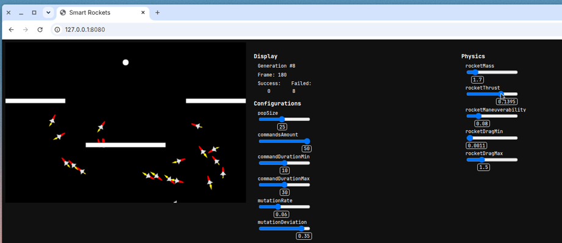

# Smart Rockets

A p5.js genetic algorithm demo. Rockets steer with a series of commands stored in its DNA. The most successful rockets pass their genes to the next generation; mutations in those genes can improve performance.

Based on Daniel Shiffman's Smart Rockets example from [The Nature of Code](https://natureofcode.com/book/chapter-9-the-evolution-of-code/), chapter 9 (The Evolution of Code).

A later version of this project is [sentient-rockets](https://github.com/dservidie/sentient-rockets) ([live demo](https://dservidie.github.io/sentient-rockets/)).



## How to run

No build step. Files at the repository root are enough to host the demo, including on GitHub Pages from the default branch (`master`).

Open `index.html` in a browser, or serve the folder:

```bash
python3 -m http.server 8080
```

Then open http://localhost:8080/

An earlier CodePen demo is at https://codepen.io/daniel-servidie/project/editor/ZBkMkQ
